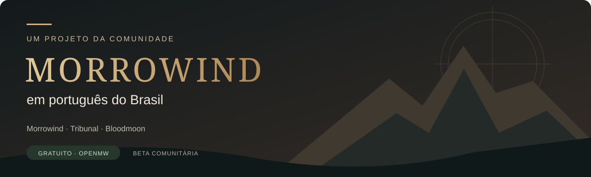
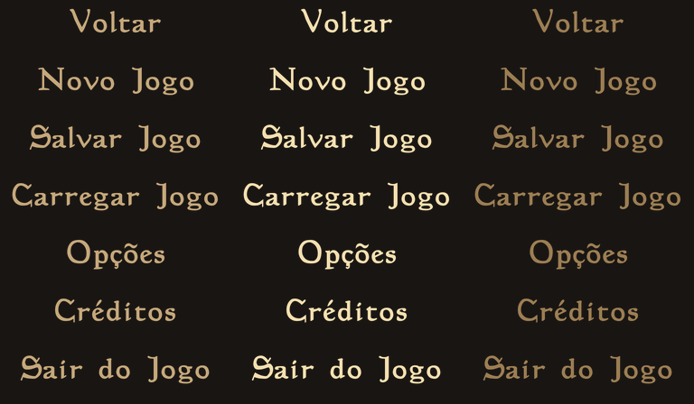

<div align="center">



# Morrowind em português do Brasil

### Vvardenfell tem muita história para contar. Agora, em português.

**Morrowind + Tribunal + Bloodmoon · OpenMW 0.51.0 · Gratuito · Beta comunitária**

[](https://github.com/chadvictor/morrowind-traducao-ptbr/releases)
[](CONTRIBUTING.md)

[Instalação](docs/INSTALACAO.md) · [O que está traduzido](docs/COBERTURA.md) · [Compatibilidade](docs/COMPATIBILIDADE.md) · [Reportar problema](https://github.com/chadvictor/morrowind-traducao-ptbr/issues/new/choose)

</div>

Uma tradução de fã para jogar **The Elder Scrolls III: Morrowind** em português brasileiro pelo **OpenMW**. O projeto reúne os textos traduzidos, os recursos de interface e um mod pronto para instalar, com arquivos abertos para revisão e contribuição da comunidade.

**Versão atual: `0.1.0-beta.2` — mod pronto, sem Python para jogar.** A tradução inicial foi produzida com auxílio de IA, revisão automatizada, decisões editoriais pontuais e validação técnica. **Ainda não houve revisão humana integral nem teste completo da campanha.** Precisamos de jogadores para aperfeiçoar a linguagem e conferir missões em contexto.

## Quero jogar

Você precisa de **Morrowind GOTY em inglês com Tribunal e Bloodmoon** e **OpenMW 0.51.0** funcionando com o jogo original. Testado no Windows com a edição Steam; outras edições/sistemas ainda precisam de validação. **Não precisa de Python, conta, chave de API ou pagamento.**

1. Baixe **[morrowind-ptbr-openmw-mod-0.1.0-beta.2.zip](https://github.com/chadvictor/morrowind-traducao-ptbr/releases/download/v0.1.0-beta.2/morrowind-ptbr-openmw-mod-0.1.0-beta.2.zip)** e extraia em uma pasta permanente.
2. No **OpenMW Launcher → Data Files → Data Directories**, adicione a pasta **`Data Files` do mod**, depois dos dados originais.
3. Marque **`Morrowind_PTBR.esp`** depois de **Morrowind.esm → Tribunal.esm → Bloodmoon.esm**. Use a codificação **English / Windows-1252** e comece um jogo novo.

**[Guia de instalação com os ajustes de interface →](docs/INSTALACAO.md)** O ESP e os recursos traduzem o conteúdo do jogo. Para completar menus modernos, perguntas de criação de personagem e mensagens de nível, o guia mostra os pequenos ajustes de idioma e os 63 fallbacks incluídos em `Extras/`. O launcher traduzido é um extra opcional.

É um mod convencional: **plugin `.esp` + mapas de localização + recursos**, carregados depois do jogo original. O ZIP não contém masters completos nem substitui seus `.esm`. Para remover, desative o plugin, retire a pasta de dados e reverta os extras aplicados.

**Já usava a beta.1 ou masters traduzidos?** [Desative a instalação antiga primeiro](docs/INSTALACAO.md#atualizar-da-beta1-ou-do-pacote-antigo); não combine os dois formatos.

<details>
<summary>Opção avançada: reconstruir com Python</summary>

O pacote `morrowind-ptbr-fontes-python-0.1.0-beta.2.zip` contém fontes e a alternativa de reconstrução local. Python é necessário apenas para usar essas ferramentas. [Guia avançado](docs/RECONSTRUCAO-PYTHON.md). Para editar traduções e gerar o plugin, consulte [CONTRIBUTING.md](CONTRIBUTING.md).

</details>

> **Leia antes de instalar:** esta beta usa mudanças coordenadas de tópicos de diálogo e scripts. Saves antigos e mods em inglês podem conflitar. O executável original `Morrowind.exe`, MWSE e outras versões do OpenMW **não são alvos validados**. [Detalhes de compatibilidade →](docs/COMPATIBILIDADE.md)

## O que está traduzido

| Área | Nesta beta |
|---|---|
| Diálogos e tópicos | Textos extraídos dos três masters; links de diálogo preservados pelo pacote |
| Missões e diário | Entradas de journal e títulos de missões |
| Livros e descrições | Conteúdo textual extraído e marcação preservada |
| Mundo e inventário | Nomes exibidos de locais, itens, magias, criaturas, personagens e outros registros do catálogo |
| Interface | Mensagens e recursos OpenMW; idioma moderno, calendário e perguntas dependem dos ajustes de `Extras/` |
| Launcher e assistente | Extra opcional Qt em pt-BR, instalado separadamente; depende também do idioma do sistema |
| Botões do menu principal | 21 imagens tipográficas novas, nos estados normal, selecionado e pressionado |
| Vozes, filmes e demais imagens | **Não traduzidos**; sem dublagem, legendagem nova de vídeos ou tradução de todos os textos em texturas |

O trabalho de origem abrangeu **52.190 entradas**, divididas em **52.380 segmentos aprovados no processo de tradução**. Esses números descrevem o catálogo processado; não significam que todas as superfícies do jogo foram traduzidas ou que cada frase recebeu revisão humana.

O repositório contém **43.694 campos modificados** dos masters, além dos mapas e recursos de interface. A release pronta consolida as alterações em um ESP; registros de diálogo incluem os campos necessários para preservar filtros e ordem. O restante do mundo vem da instalação original. Uma entrada do catálogo de trabalho não corresponde necessariamente a um campo final do patch. [Cobertura e limitações →](docs/COBERTURA.md)

<details>
<summary>Prévia dos botões traduzidos</summary>



Prévia das imagens geradas para o menu; não é uma captura de uma campanha jogada.

</details>

## Ajude a melhorar

**Você pode contribuir sem programar.** Encontrou uma frase estranha, termo inconsistente, problema com acentos ou missão que não avança? Abra uma issue com o texto, o contexto e, se possível, uma captura da tela.

Para corrigir diretamente, edite o campo `text` nos catálogos em `traducoes/`, rode a validação e abra um pull request. O [guia de contribuição](CONTRIBUTING.md) explica como localizar a frase, consultar o original da sua instalação, testar uma alteração e preservar os marcadores usados pelo jogo.

Prioridades: revisão linguística em contexto, padronização de termos, testes de missões, legibilidade da interface e documentação de novas edições compatíveis. Sugestões são bem-vindas; não há promessa de prazo de resposta.

## Organização do repositório

```text
traducoes/          # Campos editáveis, separados por master e categoria
conteudo/          # Mapas de localização, interface e imagens traduzidas
interface/qt/      # Fontes editáveis dos catálogos Qt (.ts)
compatibilidade/   # Hashes, identidades e regras estruturais
scripts/           # Ferramentas opcionais: gerar ESP, reconstruir e validar
tests/             # Testes do instalador e da preservação de dados
docs/              # Instalação, cobertura, compatibilidade e manutenção
.github/           # Validação automática, modelos de issues e de PR
LICENSES/          # Licenças dos componentes de terceiros
```

**Este repositório não contém a ferramenta privada de tradução por IA**, prompts, clientes de API, chaves, checkpoints financeiros, bancos de trabalho ou executáveis comerciais. Os scripts publicados servem exclusivamente para aplicar, validar e distribuir os arquivos da tradução.

## Licença e créditos

O código original de instalação, documentação e contribuições autorais deste projeto são disponibilizados sob a [licença MIT](LICENSE), na extensão dos direitos dos colaboradores. Os arquivos derivados do OpenMW mantêm a licença GPL-3.0; os avisos e atribuições estão em [THIRD_PARTY_NOTICES.md](THIRD_PARTY_NOTICES.md).

**A MIT não licencia Morrowind, sua história, seus personagens, marcas ou outros conteúdos da Bethesda.** Este é um projeto de fãs independente, não oficial e sem afiliação com Bethesda ou com a equipe do OpenMW. É necessário possuir o jogo original.

Projeto mantido por [chadvictor](https://github.com/chadvictor), com espaço aberto para os créditos de futuras contribuições. [Créditos e origem do trabalho →](docs/CREDITOS.md)
